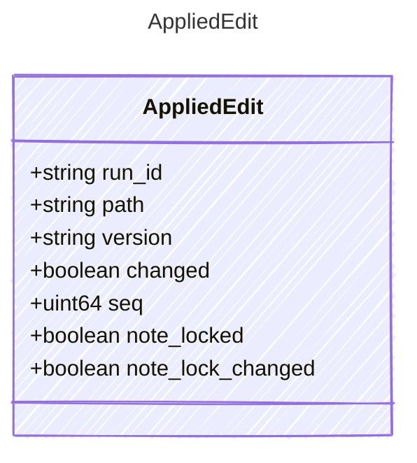

<!-- <auto-generated by typra-emitter> -->

One batch applied to one document (`edit`, `apply_ops`).

## Class Diagram

## Properties

| Name | Type | Description |
| ---- | ---- | ----------- |
| run_id | string |  |
| path | string | Project-relative path. |
| version | string | The document's version after the batch: what the next edit expects. |
| changed | boolean | False when the batch left the bytes as they were; nothing was logged. |
| seq | uint64 | The op-log entry of the write, or null when nothing changed. |
| note_locked | boolean | For notes: the lock now in force. |
| note_lock_changed | boolean | For notes: the batch changed the lock. |
