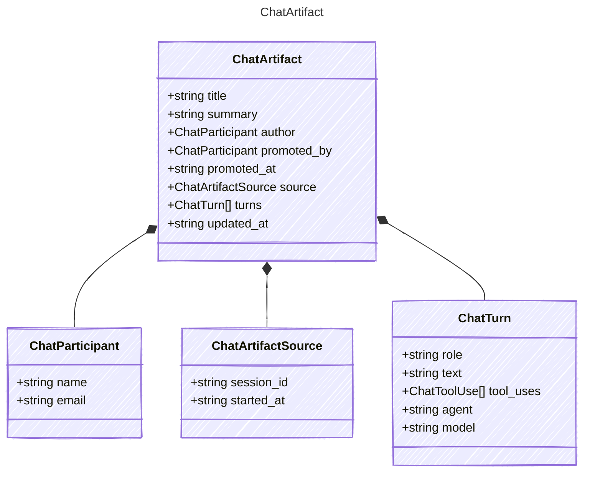

<!-- <auto-generated by typra-emitter> -->

A `.cv` file: a private chat promoted into the shared project.
The transcript never changes after promotion; only `title` and `summary` do.
Unknown top-level and turn fields must survive every runtime's decode -> save.

## Class Diagram



## Yaml Example

```yaml
title: Plan the launch demo
promoted_at: 2026-07-01T09:30:00Z
updated_at: 2026-07-01T09:30:00Z
```

## Properties

| Name | Type | Description |
| ---- | ---- | ----------- |
| title | string |  |
| summary | string | Markdown. Omitted when blank. |
| author | [ChatParticipant](../chatparticipant/) | Who held the conversation. |
| promoted_by | [ChatParticipant](../chatparticipant/) | Who promoted it into the project. |
| promoted_at | string | RFC 3339 UTC timestamp. |
| source | [ChatArtifactSource](../chatartifactsource/) |  |
| turns | [ChatTurn[]](../chatturn/) |  |
| updated_at | string | RFC 3339 UTC timestamp, set by every title or summary edit. |

## Composed Types

The following types are composed within `ChatArtifact`:

- [ChatParticipant](../chatparticipant/)
- [ChatArtifactSource](../chatartifactsource/)
- [ChatTurn](../chatturn/)
