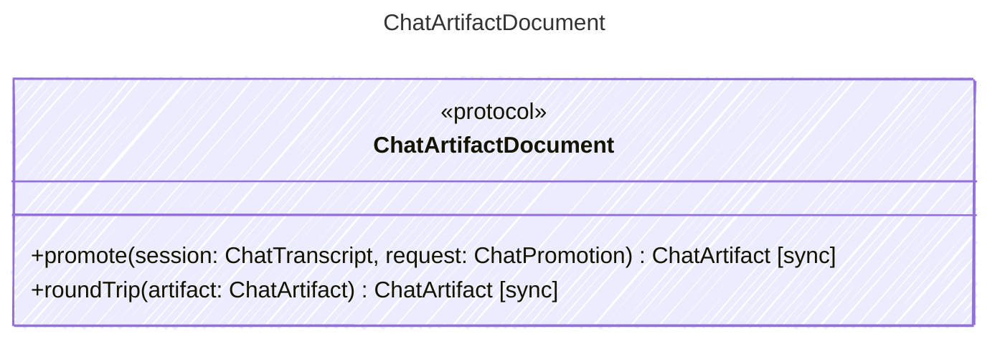

<!-- <auto-generated by typra-emitter> -->

Behavioral contract for `.cv` documents. Each runtime binds these operations
to its production code through a thin vector adapter.

## Class Diagram

## Helper Methods

The following helper methods are declared via `@method` and must be implemented by every runtime. The schema declares the logical protocol contract; each runtime maps async-capable methods to idiomatic sync/async shapes for that language.

| Name | Signature | Runtime shape | Description |
| ---- | --------- | ------------- | ----------- |
| `promote` | `promote(session: ChatTranscript, request: ChatPromotion) -> ChatArtifact` | sync | Curate a private chat into a `.cv` document. Text is trimmed throughout.

- Only `user` and `assistant` messages are kept, and none marked `pending`.
- A message's text is its string `content`, or its `text` parts joined by a
newline. Images are dropped, then user messages without text.
- Each user message is a turn. Consecutive assistant messages fold into one
turn: their non-blank texts joined by a blank line, every named
`tool_calls` entry as a tool use, and `agent` and `model` from the last
`cutready.runDetails` (`agent_id`, `model`). A turn with no text and no
tool uses is dropped.
- A tool use's `target` is the first non-blank string among `path` and
`url` in the call's JSON `arguments`.
- `selected_turns` keeps the listed curated turns in transcript order;
out-of-range and repeated indices are ignored.
- `source.started_at` is the session's `created_at`; `updated_at` is
`promoted_at`; a blank `summary` is omitted.

Tool arguments and results, working notes, and images stay private. |
| `roundTrip` | `roundTrip(artifact: ChatArtifact) -> ChatArtifact` | sync | Decode a `.cv` document and save it again. A blank `summary` and empty
`tool_uses` are omitted. |
