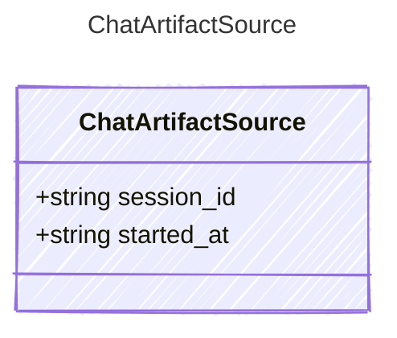

<!-- <auto-generated by typra-emitter> -->

The private session a chat artifact was promoted from.

## Class Diagram



## Yaml Example

```yaml
session_id: chat-1
```

## Properties

| Name | Type | Description |
| ---- | ---- | ----------- |
| session_id | string |  |
| started_at | string | RFC 3339 timestamp. Omitted when unknown. |
