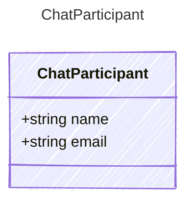

<!-- <auto-generated by typra-emitter> -->

A person, as recorded by their git identity.

## Class Diagram



## Yaml Example

```yaml
name: Ada Lovelace
```

## Properties

| Name | Type | Description |
| ---- | ---- | ----------- |
| name | string |  |
| email | string | Omitted when unknown. |
