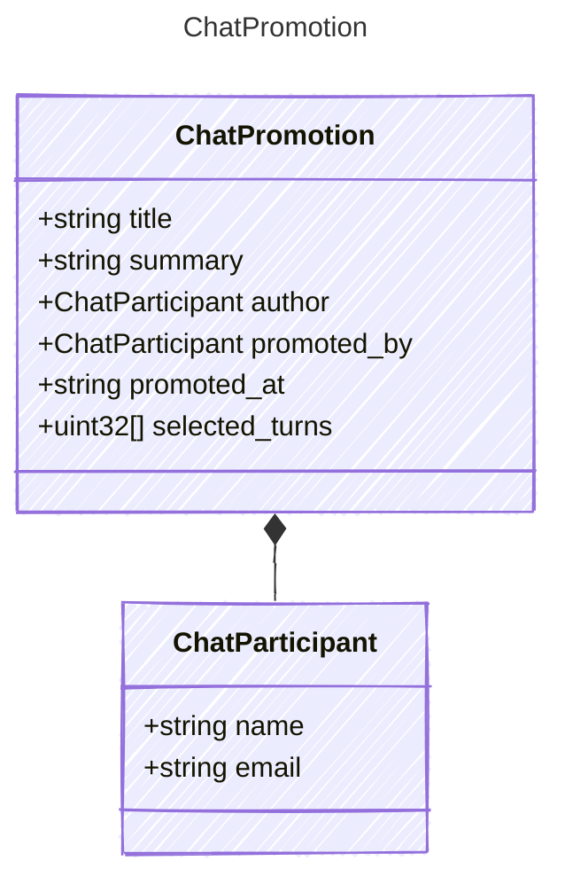

<!-- <auto-generated by typra-emitter> -->

What to promote, and who promoted it. The host supplies identities and the clock.

## Class Diagram



## Yaml Example

```yaml
title: Plan the launch demo
promoted_at: 2026-07-01T09:30:00Z
```

## Properties

| Name | Type | Description |
| ---- | ---- | ----------- |
| title | string |  |
| summary | string | Markdown. |
| author | [ChatParticipant](../chatparticipant/) |  |
| promoted_by | [ChatParticipant](../chatparticipant/) |  |
| promoted_at | string | RFC 3339 UTC timestamp. Also becomes `updated_at`. |
| selected_turns | uint32[] | Zero-based indices into the curated turns. Omitted keeps every turn. |

## Composed Types

The following types are composed within `ChatPromotion`:

- [ChatParticipant](../chatparticipant/)
