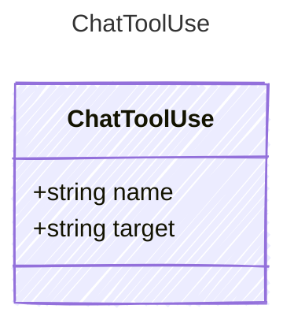

<!-- <auto-generated by typra-emitter> -->

A tool call, without its arguments or result.

## Class Diagram



## Yaml Example

```yaml
name: write_sketch
```

## Properties

| Name | Type | Description |
| ---- | ---- | ----------- |
| name | string |  |
| target | string | The project path or URL the call acted on. Omitted when none. |
