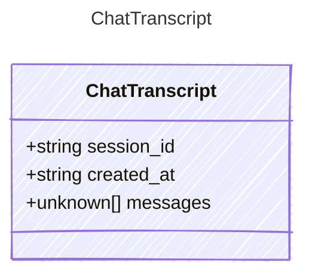

<!-- <auto-generated by typra-emitter> -->

A private chat session, as the desktop stores it.

## Class Diagram



## Yaml Example

```yaml
session_id: chat-1
```

## Properties

| Name | Type | Description |
| ---- | ---- | ----------- |
| session_id | string |  |
| created_at | string | RFC 3339 timestamp. Omitted when unknown. |
| messages | unknown[] | Messages in chat-completions shape: `role`, `content` (a string, an array
of `text` and `image_url` parts, or null), and `tool_calls`, plus CutReady's
`pending` flag and `cutready` metadata. |
