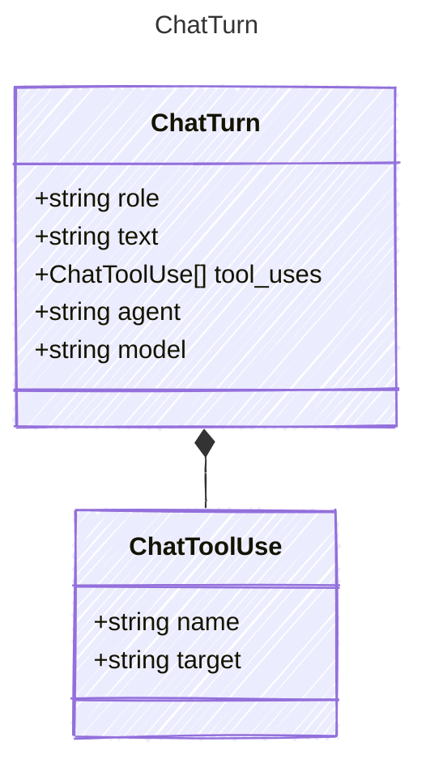

<!-- <auto-generated by typra-emitter> -->

A user message, or everything the assistant said and did before the next one.

## Class Diagram



## Yaml Example

```yaml
text: Draft an intro sketch.
```

## Properties

| Name | Type | Description |
| ---- | ---- | ----------- |
| role | string |  |
| text | string | Markdown. |
| tool_uses | [ChatToolUse[]](../chattooluse/) | Tools the assistant called, in order. Omitted when none. |
| agent | string | The CutReady agent that answered, such as `planner`. |
| model | string | The model that answered. |

## Composed Types

The following types are composed within `ChatTurn`:

- [ChatToolUse](../chattooluse/)
