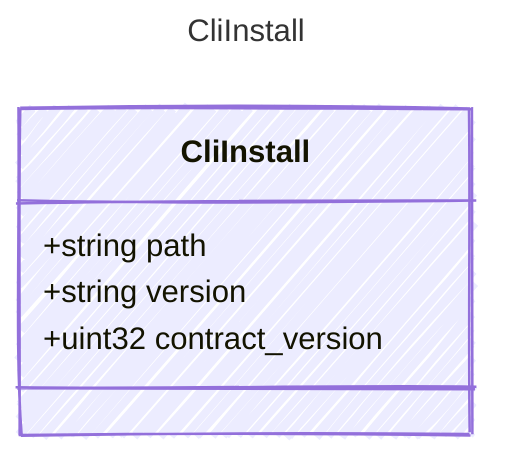

<!-- <auto-generated by typra-emitter> -->

One installed `cutready-cli`, as `register` records it and `discover` reports it.

## Class Diagram

## Properties

| Name | Type | Description |
| ---- | ---- | ----------- |
| path | string | Absolute path of the binary. |
| version | string | Its SemVer version. |
| contract_version | uint32 | The edit contract it speaks. |
