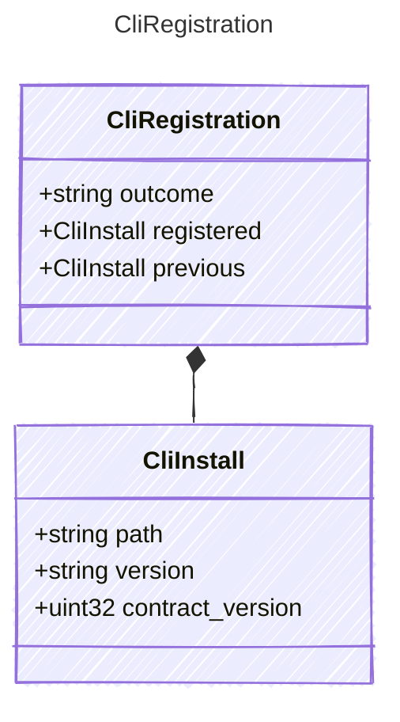

<!-- <auto-generated by typra-emitter> -->

`register`: the install now registered, which is this one unless a newer one was kept.

## Class Diagram

## Properties

| Name | Type | Description |
| ---- | ---- | ----------- |
| outcome | string |  |
| registered | [CliInstall](../cliinstall/) |  |
| previous | [CliInstall](../cliinstall/) | The install `replaced` replaced. |

## Composed Types

The following types are composed within `CliRegistration`:

- [CliInstall](../cliinstall/)
