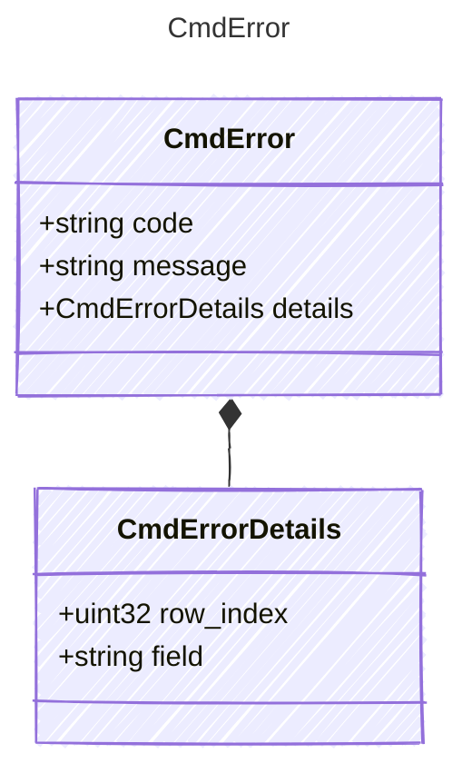

<!-- <auto-generated by typra-emitter> -->

The error envelope every runtime reports when it rejects a command, in
Draftline's `TauriCommandError` shape. `message` is human-readable text each
runtime words for itself; vectors pin `code` and `details` only.

## Class Diagram

## Properties

| Name | Type | Description |
| ---- | ---- | ----------- |
| code | string |  |
| message | string |  |
| details | [CmdErrorDetails](../cmderrordetails/) |  |

## Composed Types

The following types are composed within `CmdError`:

- [CmdErrorDetails](../cmderrordetails/)
