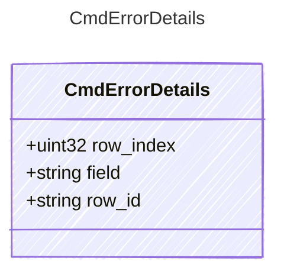

<!-- <auto-generated by typra-emitter> -->

Structured context for a CmdError. Each code documents the fields it sets.

## Class Diagram

## Properties

| Name | Type | Description |
| ---- | ---- | ----------- |
| row_index | uint32 | Zero-based row position, for row-scoped errors. |
| field | string | The locked cell, for `locked_cell`. |
| row_id | string | The repeated row id, for `duplicate_row_id`. |
