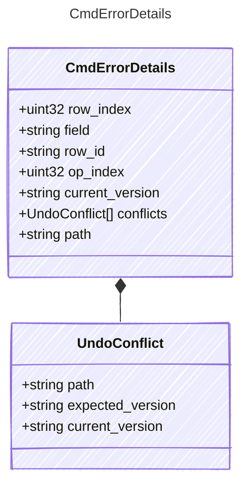

<!-- <auto-generated by typra-emitter> -->

Structured context for a CmdError. Each code documents the fields it sets.

## Class Diagram

## Properties

| Name | Type | Description |
| ---- | ---- | ----------- |
| row_index | uint32 | Zero-based row position, for row-scoped errors. |
| field | string | The locked cell, for `locked_cell`. |
| row_id | string | The repeated row id for `duplicate_row_id`; the missing one for `row_not_found`. |
| op_index | uint32 | Zero-based position of the rejected op in an `EditService` batch. |
| current_version | string | The document version on disk, for `stale_document`. |
| conflicts | [UndoConflict[]](../undoconflict/) | The entities that block an undo, for `undo_conflict`. |
| path | string | The project-relative file that already exists, for `file_exists`. |

## Composed Types

The following types are composed within `CmdErrorDetails`:

- [UndoConflict](../undoconflict/)
