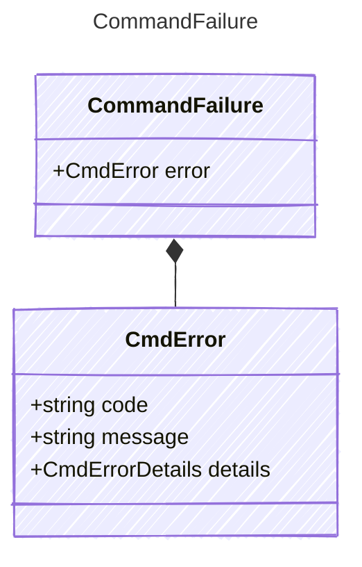

<!-- <auto-generated by typra-emitter> -->

What a failed command prints.

## Class Diagram

## Properties

| Name | Type | Description |
| ---- | ---- | ----------- |
| error | [CmdError](../cmderror/) |  |

## Composed Types

The following types are composed within `CommandFailure`:

- [CmdError](../cmderror/)
