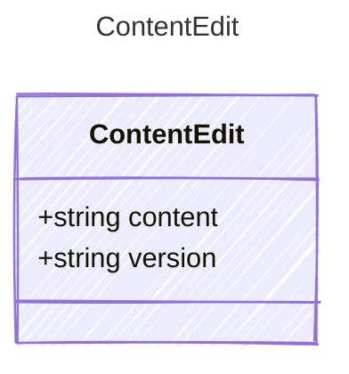

<!-- <auto-generated by typra-emitter> -->

Bytes to write and their `EditService.documentVersion`.

## Class Diagram

## Properties

| Name | Type | Description |
| ---- | ---- | ----------- |
| content | string |  |
| version | string |  |
