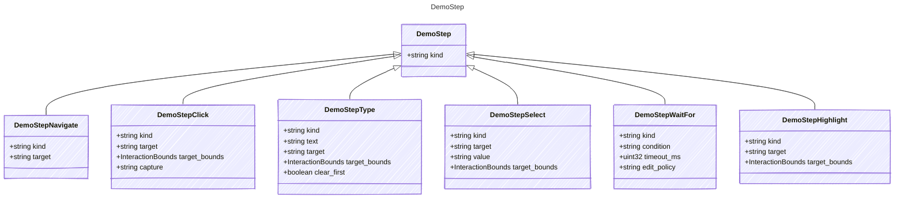

<!-- <auto-generated by typra-emitter> -->

Normalized walkthrough intent between `demo_actions` prose and replay actions.

## Class Diagram

## Properties

| Name | Type | Description |
| ---- | ---- | ----------- |
| kind | string |  |

## Child Types

The following types extend `DemoStep`:

- [DemoStepNavigate](../demostepnavigate/)
- [DemoStepClick](../demostepclick/)
- [DemoStepType](../demosteptype/)
- [DemoStepSelect](../demostepselect/)
- [DemoStepWaitFor](../demostepwaitfor/)
- [DemoStepHighlight](../demostephighlight/)
