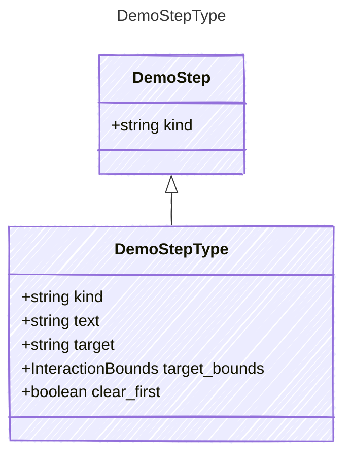

<!-- <auto-generated by typra-emitter> -->

## Class Diagram

## Properties

| Name | Type | Description |
| ---- | ---- | ----------- |
| kind | string |  |
| text | string |  |
| target | string |  |
| target_bounds | [InteractionBounds](../interactionbounds/) |  |
| clear_first | boolean |  |
