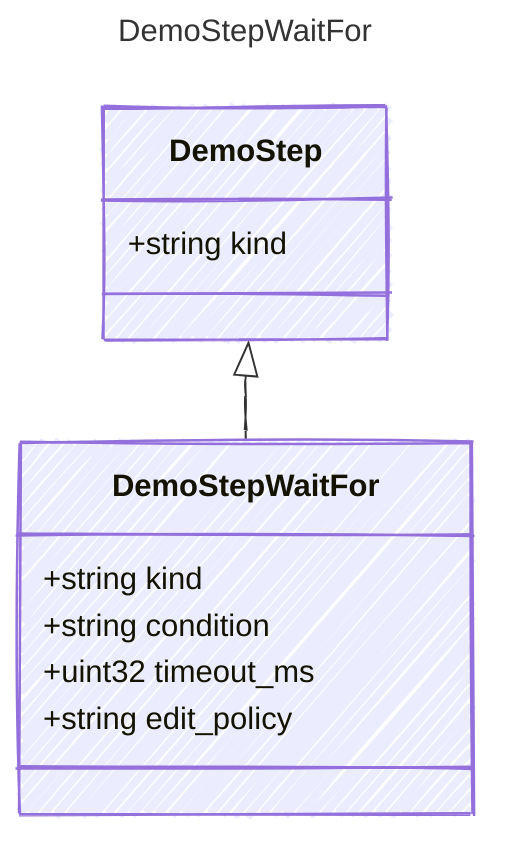

<!-- <auto-generated by typra-emitter> -->

## Class Diagram

## Properties

| Name | Type | Description |
| ---- | ---- | ----------- |
| kind | string |  |
| condition | string |  |
| timeout_ms | uint32 |  |
| edit_policy | string |  |
