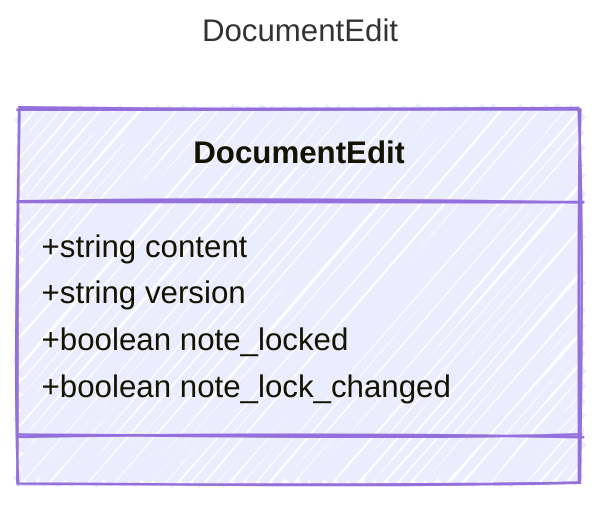

<!-- <auto-generated by typra-emitter> -->

Bytes to write and their `EditService.documentVersion`. For notes,
`note_locked` is the lock to keep and `note_lock_changed` says whether the
host must save it; a note batch either edits content or locks, never both.

## Class Diagram

## Properties

| Name | Type | Description |
| ---- | ---- | ----------- |
| content | string |  |
| version | string |  |
| note_locked | boolean |  |
| note_lock_changed | boolean |  |
