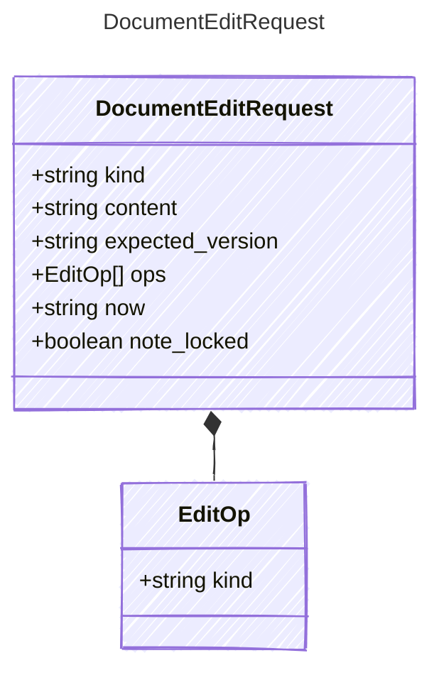

<!-- <auto-generated by typra-emitter> -->

One write to one project file.

## Class Diagram

## Properties

| Name | Type | Description |
| ---- | ---- | ----------- |
| kind | string |  |
| content | string | The file on disk, or null when it doesn't exist. |
| expected_version | string | The version the ops were computed against, or null to expect no file. |
| ops | [EditOp[]](../editop/) | (Related Types: [SetTitleOp](../settitleop/), [SetDescriptionOp](../setdescriptionop/), [SetMetadataOp](../setmetadataop/), [SetRowTextOp](../setrowtextop/), [SetScreenshotOp](../setscreenshotop/), [SetVisualOp](../setvisualop/), [InsertRowOp](../insertrowop/), [DeleteRowOp](../deleterowop/), [ReorderRowsOp](../reorderrowsop/), [UpdateRowOp](../updaterowop/), [ReplaceRowsOp](../replacerowsop/), [SetLockOp](../setlockop/), [TouchOp](../touchop/), [ReplaceSketchOp](../replacesketchop/), [ReplaceStoryboardOp](../replacestoryboardop/), [ReplaceNoteOp](../replacenoteop/), [WriteNoteOp](../writenoteop/), [InsertStoryboardItemOp](../insertstoryboarditemop/), [RemoveStoryboardItemOp](../removestoryboarditemop/), [SetStoryboardItemsOp](../setstoryboarditemsop/)) |
| now | string |  |
| note_locked | boolean | The note's lock from the host's lock store; ignored for other kinds. |

## Composed Types

The following types are composed within `DocumentEditRequest`:

- [EditOp](../editop/)
