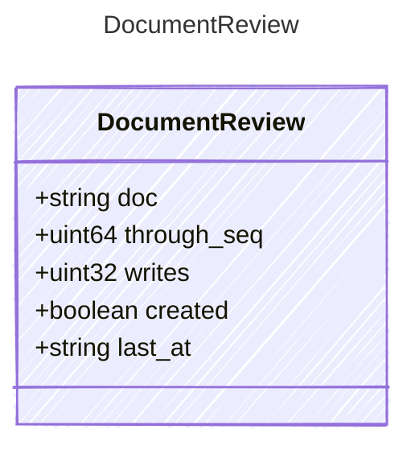

<!-- <auto-generated by typra-emitter> -->

One document a run changed. Keep and Undo pass `through_seq` back; if the
run wrote to the document again since, they fail with `stale_review`.

## Class Diagram

## Properties

| Name | Type | Description |
| ---- | ---- | ----------- |
| doc | string | Project-relative path. |
| through_seq | uint64 | The newest op-log entry this review covers. |
| writes | uint32 | How many writes the review covers. |
| created | boolean | The run created the document. |
| last_at | string | When the run last wrote it (RFC 3339). |
