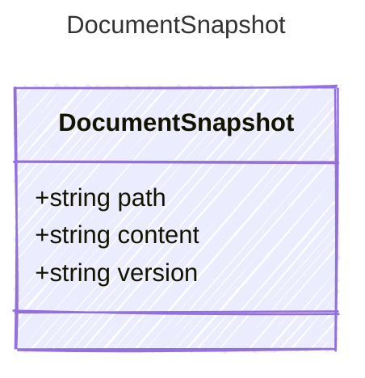

<!-- <auto-generated by typra-emitter> -->

A document as it is on disk now (`read_document`).

## Class Diagram

## Properties

| Name | Type | Description |
| ---- | ---- | ----------- |
| path | string | Project-relative path. |
| content | string | The file's text, or null when it doesn't exist. |
| version | string | `EditService.documentVersion` of the bytes; null when the file doesn't exist. |
