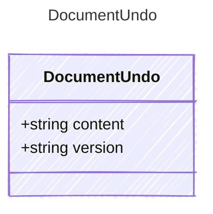

<!-- <auto-generated by typra-emitter> -->

The bytes to write (null to delete the file) and their version.

## Class Diagram

## Properties

| Name | Type | Description |
| ---- | ---- | ----------- |
| content | string |  |
| version | string |  |
