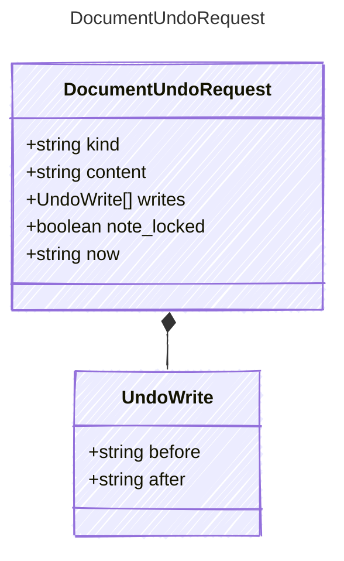

<!-- <auto-generated by typra-emitter> -->

Undo a run's writes to one document.

## Class Diagram

## Properties

| Name | Type | Description |
| ---- | ---- | ----------- |
| kind | string |  |
| content | string | The file on disk, or null when it doesn't exist. |
| writes | [UndoWrite[]](../undowrite/) | The run's writes to this document, oldest first. |
| note_locked | boolean | The note's lock from the host's lock store; ignored for other kinds. |
| now | string | RFC 3339 time stamped as `updated_at` on a merged sketch or storyboard. |

## Composed Types

The following types are composed within `DocumentUndoRequest`:

- [UndoWrite](../undowrite/)
