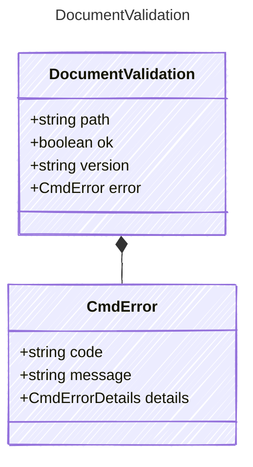

<!-- <auto-generated by typra-emitter> -->

## Class Diagram

## Properties

| Name | Type | Description |
| ---- | ---- | ----------- |
| path | string | Project-relative path. |
| ok | boolean |  |
| version | string | The version an edit must expect, when the document loads. |
| error | [CmdError](../cmderror/) | Why it doesn't load. |

## Composed Types

The following types are composed within `DocumentValidation`:

- [CmdError](../cmderror/)
