<!-- <auto-generated by typra-emitter> -->

One typed edit, addressed by stable row id. Lock rules match
`SketchDocument`: content edits are rejected on a locked sketch, locked rows,
and changed locked cells; `set_lock` is always allowed.

## Class Diagram

```mermaid
---
title: EditOp
config:
  look: handDrawn
  theme: colorful
  class:
    hideEmptyMembersBox: true
---
classDiagram
    class EditOp {
        +string kind
    }
    class SetTitleOp {
        +string kind
        +string title
    }
    EditOp <|-- SetTitleOp
    class SetDescriptionOp {
        +string kind
        +unknown description
    }
    EditOp <|-- SetDescriptionOp
    class SetMetadataOp {
        +string kind
        +DocumentMetadata metadata
    }
    EditOp <|-- SetMetadataOp
    class SetRowTextOp {
        +string kind
        +string row_id
        +string time
        +string narrative
        +string demo_actions
    }
    EditOp <|-- SetRowTextOp
    class SetScreenshotOp {
        +string kind
        +string row_id
        +string screenshot
    }
    EditOp <|-- SetScreenshotOp
    class SetVisualOp {
        +string kind
        +string row_id
        +string visual
    }
    EditOp <|-- SetVisualOp
    class InsertRowOp {
        +string kind
        +string after_row_id
        +PlanningRow row
    }
    EditOp <|-- InsertRowOp
    class DeleteRowOp {
        +string kind
        +string row_id
    }
    EditOp <|-- DeleteRowOp
    class ReorderRowsOp {
        +string kind
        +string[] row_ids
    }
    EditOp <|-- ReorderRowsOp
    class UpdateRowOp {
        +string kind
        +PlanningRow row
    }
    EditOp <|-- UpdateRowOp
    class ReplaceRowsOp {
        +string kind
        +PlanningRow[] rows
    }
    EditOp <|-- ReplaceRowsOp
    class SetLockOp {
        +string kind
        +string row_id
        +string field
        +boolean locked
    }
    EditOp <|-- SetLockOp
```

## Properties

| Name | Type | Description |
| ---- | ---- | ----------- |
| kind | string |  |

## Child Types

The following types extend `EditOp`:

- [SetTitleOp](../settitleop/)
- [SetDescriptionOp](../setdescriptionop/)
- [SetMetadataOp](../setmetadataop/)
- [SetRowTextOp](../setrowtextop/)
- [SetScreenshotOp](../setscreenshotop/)
- [SetVisualOp](../setvisualop/)
- [InsertRowOp](../insertrowop/)
- [DeleteRowOp](../deleterowop/)
- [ReorderRowsOp](../reorderrowsop/)
- [UpdateRowOp](../updaterowop/)
- [ReplaceRowsOp](../replacerowsop/)
- [SetLockOp](../setlockop/)
