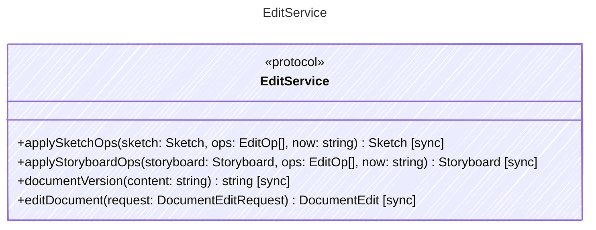

<!-- <auto-generated by typra-emitter> -->

The one way every host edits a document. Ops apply in order and atomically:
the first rejected op fails the batch with `details.op_index` and the
document is unchanged. A successful batch sets `updated_at` to `now` once,
unless every op is a replacement. Notes have no `updated_at`.

## Class Diagram

## Helper Methods

The following helper methods are declared via `@method` and must be implemented by every runtime. The schema declares the logical protocol contract; each runtime maps async-capable methods to idiomatic sync/async shapes for that language.

| Name | Signature | Runtime shape | Description |
| ---- | --------- | ------------- | ----------- |
| `applySketchOps` | `applySketchOps(sketch: Sketch, ops: EditOp[], now: string) -> Sketch` | sync | Apply ops to a `.sk` document. |
| `applyStoryboardOps` | `applyStoryboardOps(storyboard: Storyboard, ops: EditOp[], now: string) -> Storyboard` | sync | Apply ops to a `.sb` document. |
| `documentVersion` | `documentVersion(content: string) -> string` | sync | The version an edit was computed against: `sha256:` plus the lowercase
hex SHA-256 of the document's bytes on disk. A write whose expected
version differs fails with `stale_document`. |
| `editDocument` | `editDocument(request: DocumentEditRequest) -> DocumentEdit` | sync | The host write path for every project document. A version mismatch fails
with `stale_document` (with `details.current_version` when the file
exists). A missing file must start with its kind's replacement op,
otherwise the batch is `invalid_op`. A batch that starts with the
replacement op doesn't read the old bytes, so it can overwrite a file that
no longer parses. The result is the canonical bytes to
write and their version. An empty batch returns `content` unchanged. |
