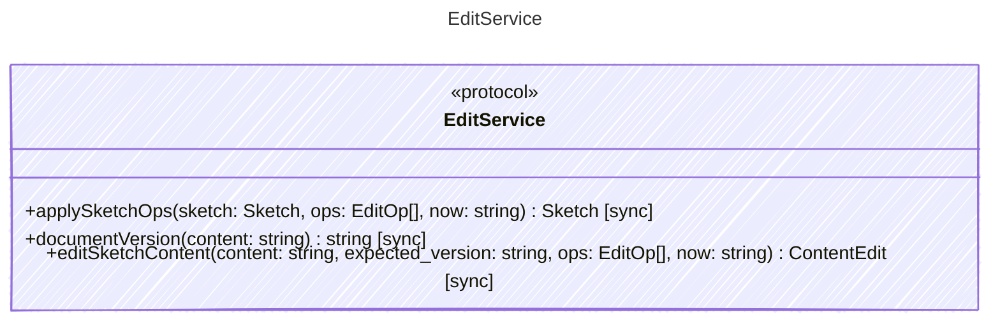

<!-- <auto-generated by typra-emitter> -->

The one way every host edits a document. Ops apply in order and atomically:
the first rejected op fails the batch with `details.op_index` and the
document is unchanged. A successful batch sets `updated_at` to `now` once.

## Class Diagram

## Helper Methods

The following helper methods are declared via `@method` and must be implemented by every runtime. The schema declares the logical protocol contract; each runtime maps async-capable methods to idiomatic sync/async shapes for that language.

| Name | Signature | Runtime shape | Description |
| ---- | --------- | ------------- | ----------- |
| `applySketchOps` | `applySketchOps(sketch: Sketch, ops: EditOp[], now: string) -> Sketch` | sync | Apply ops to a `.sk` document. |
| `documentVersion` | `documentVersion(content: string) -> string` | sync | The version an edit was computed against: `sha256:` plus the lowercase
hex SHA-256 of the document's bytes on disk. A write whose expected
version differs fails with `stale_document`. |
| `editSketchContent` | `editSketchContent(content: string, expected_version: string, ops: EditOp[], now: string) -> ContentEdit` | sync | The host write path for a `.sk` file. `content` is the file on disk and
`expected_version` the version the ops were computed against; a mismatch
fails with `stale_document` and `details.current_version`. Otherwise the
ops apply and the result is the canonical bytes to write and their
version. An empty batch returns `content` unchanged. |
