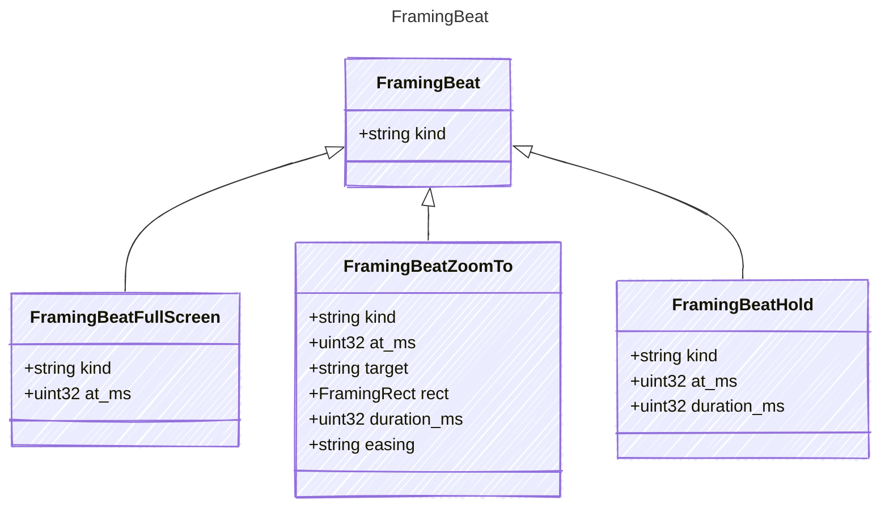

<!-- <auto-generated by typra-emitter> -->

Editorial camera intent for a row, separate from interaction replay.
`at_ms` is relative to the start of the row; save always writes it.

## Class Diagram

## Properties

| Name | Type | Description |
| ---- | ---- | ----------- |
| kind | string |  |

## Child Types

The following types extend `FramingBeat`:

- [FramingBeatFullScreen](../framingbeatfullscreen/)
- [FramingBeatZoomTo](../framingbeatzoomto/)
- [FramingBeatHold](../framingbeathold/)
