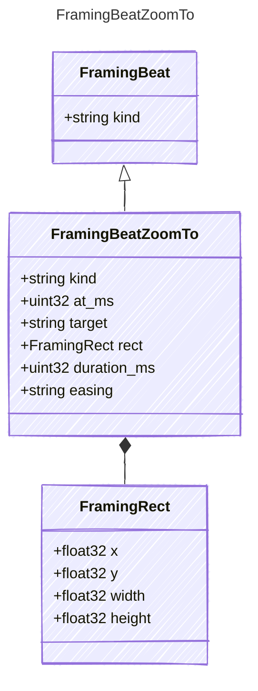

<!-- <auto-generated by typra-emitter> -->

## Class Diagram

## Properties

| Name | Type | Description |
| ---- | ---- | ----------- |
| kind | string |  |
| at_ms | uint32 |  |
| target | string |  |
| rect | [FramingRect](../framingrect/) |  |
| duration_ms | uint32 |  |
| easing | string |  |

## Composed Types

The following types are composed within `FramingBeatZoomTo`:

- [FramingRect](../framingrect/)
