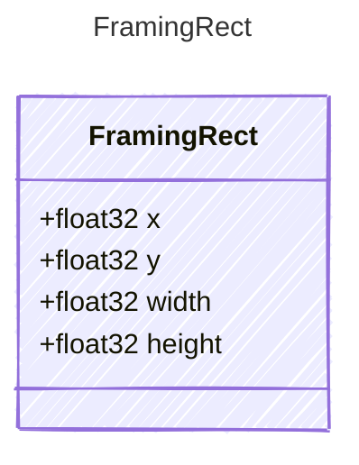

<!-- <auto-generated by typra-emitter> -->

A region normalized to the row screenshot or visual (0..1).

## Class Diagram

## Properties

| Name | Type | Description |
| ---- | ---- | ----------- |
| x | float32 |  |
| y | float32 |  |
| width | float32 |  |
| height | float32 |  |
