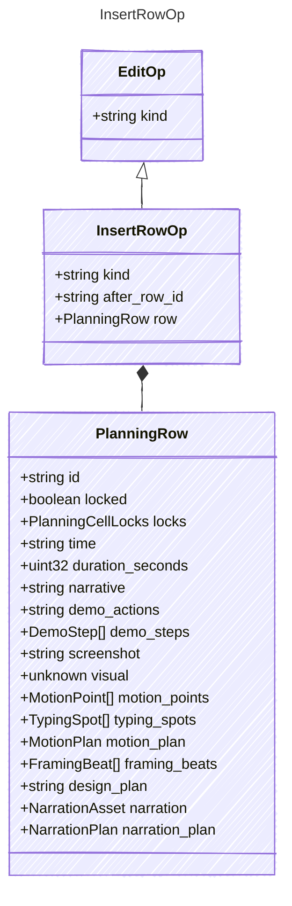

<!-- <auto-generated by typra-emitter> -->

Insert `row` after `after_row_id`, or first when it is null. The new row's
lock state is ignored: inserted rows start unlocked. A row without an id
gets one as in decode.

## Class Diagram

## Properties

| Name | Type | Description |
| ---- | ---- | ----------- |
| kind | string |  |
| after_row_id | string |  |
| row | [PlanningRow](../planningrow/) |  |

## Composed Types

The following types are composed within `InsertRowOp`:

- [PlanningRow](../planningrow/)
