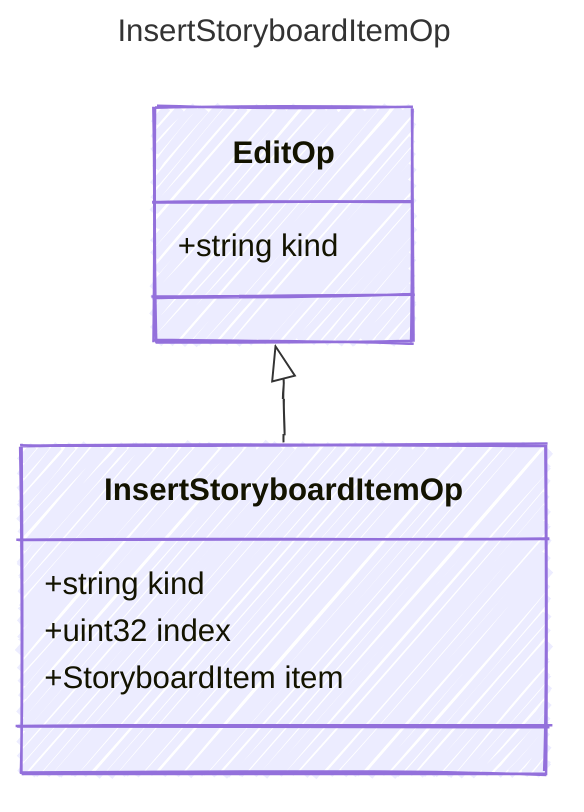

<!-- <auto-generated by typra-emitter> -->

Insert `item` at `index`; null or past the end appends.

## Class Diagram

## Properties

| Name | Type | Description |
| ---- | ---- | ----------- |
| kind | string |  |
| index | uint32 |  |
| item | [StoryboardItem](../storyboarditem/) |  |
