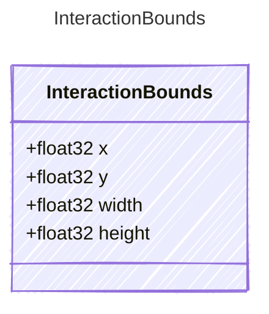

<!-- <auto-generated by typra-emitter> -->

A target region in source screenshot pixels.

## Class Diagram

## Properties

| Name | Type | Description |
| ---- | ---- | ----------- |
| x | float32 |  |
| y | float32 |  |
| width | float32 |  |
| height | float32 |  |
