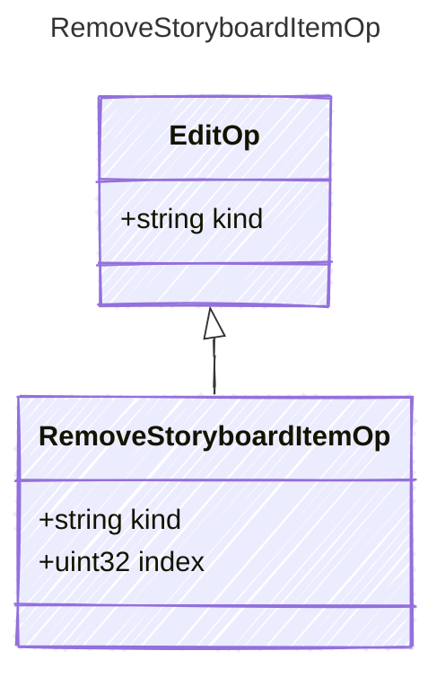

<!-- <auto-generated by typra-emitter> -->

Remove the item at `index`; an index past the end is `invalid_op`.

## Class Diagram

## Properties

| Name | Type | Description |
| ---- | ---- | ----------- |
| kind | string |  |
| index | uint32 |  |
