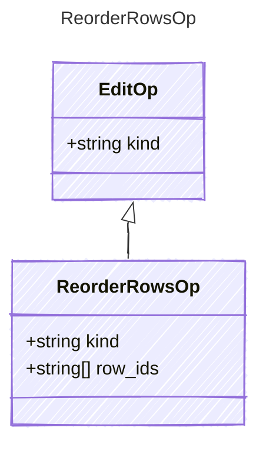

<!-- <auto-generated by typra-emitter> -->

The new order; `row_ids` lists every current row id exactly once.

## Class Diagram

## Properties

| Name | Type | Description |
| ---- | ---- | ----------- |
| kind | string |  |
| row_ids | string[] |  |
