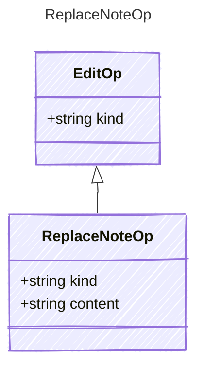

<!-- <auto-generated by typra-emitter> -->

`replace_sketch` for a note: the new markdown, ignoring the note's lock.

## Class Diagram

## Properties

| Name | Type | Description |
| ---- | ---- | ----------- |
| kind | string |  |
| content | string |  |
