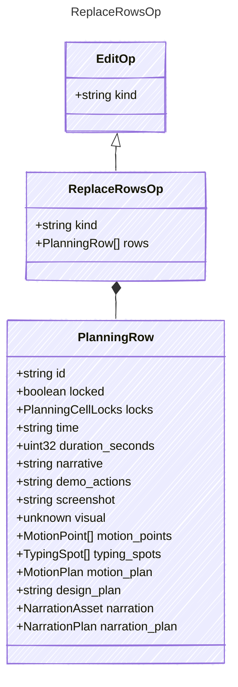

<!-- <auto-generated by typra-emitter> -->

Replace the whole planning table. Lock state stays with each position, as in
`SketchDocument`. Prefer the targeted ops; this one is for bulk rewrites.

## Class Diagram

## Properties

| Name | Type | Description |
| ---- | ---- | ----------- |
| kind | string |  |
| rows | [PlanningRow[]](../planningrow/) |  |

## Composed Types

The following types are composed within `ReplaceRowsOp`:

- [PlanningRow](../planningrow/)
