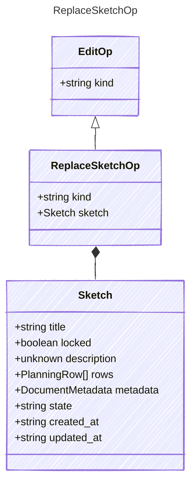

<!-- <auto-generated by typra-emitter> -->

Replace the whole document, for create and import only. A replacement
ignores the lock policy and keeps the given `updated_at`; rows without an id
get one as in decode.

## Class Diagram

## Properties

| Name | Type | Description |
| ---- | ---- | ----------- |
| kind | string |  |
| sketch | [Sketch](../sketch/) |  |

## Composed Types

The following types are composed within `ReplaceSketchOp`:

- [Sketch](../sketch/)
