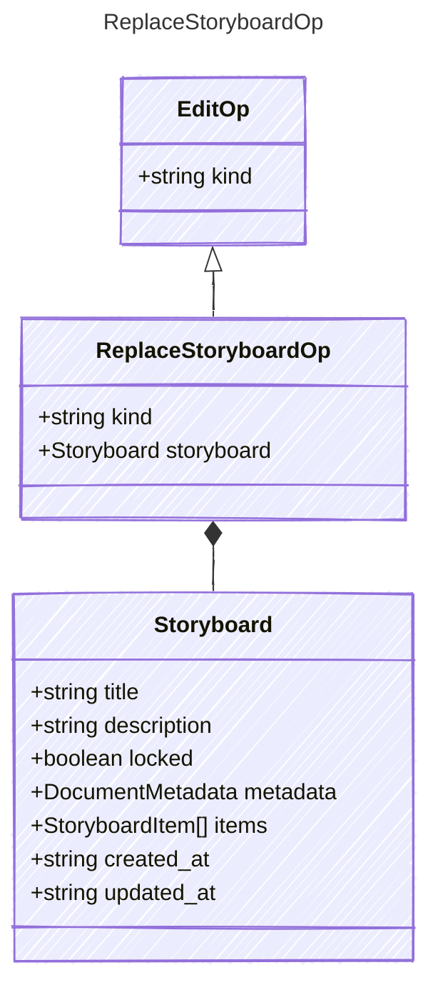

<!-- <auto-generated by typra-emitter> -->

`replace_sketch` for a storyboard, in the canonical shape. Hosts upgrade older files on read.

## Class Diagram

## Properties

| Name | Type | Description |
| ---- | ---- | ----------- |
| kind | string |  |
| storyboard | [Storyboard](../storyboard/) |  |

## Composed Types

The following types are composed within `ReplaceStoryboardOp`:

- [Storyboard](../storyboard/)
