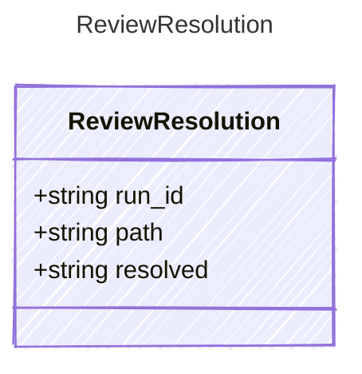

<!-- <auto-generated by typra-emitter> -->

A run's changes to one document were kept or undone (`keep`, `undo`).

## Class Diagram

## Properties

| Name | Type | Description |
| ---- | ---- | ----------- |
| run_id | string |  |
| path | string |  |
| resolved | string |  |
