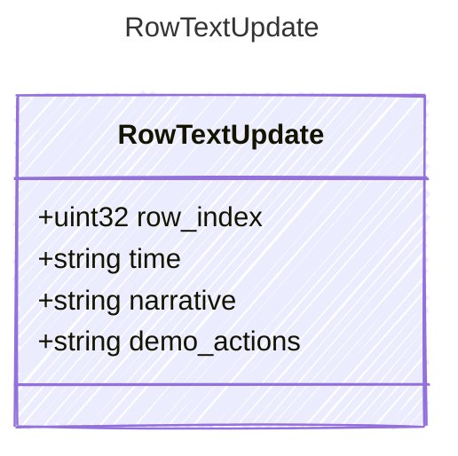

<!-- <auto-generated by typra-emitter> -->

Text cells to replace on one planning row. Omitted cells are left untouched.
A `time` that differs from the current value also sets `duration_seconds` to
`PlanningTiming.parseDurationSeconds(time)`, omitting it when that is null.
An unchanged `time` keeps the current `duration_seconds`.

## Class Diagram

## Properties

| Name | Type | Description |
| ---- | ---- | ----------- |
| row_index | uint32 | Zero-based row index. |
| time | string |  |
| narrative | string |  |
| demo_actions | string |  |
