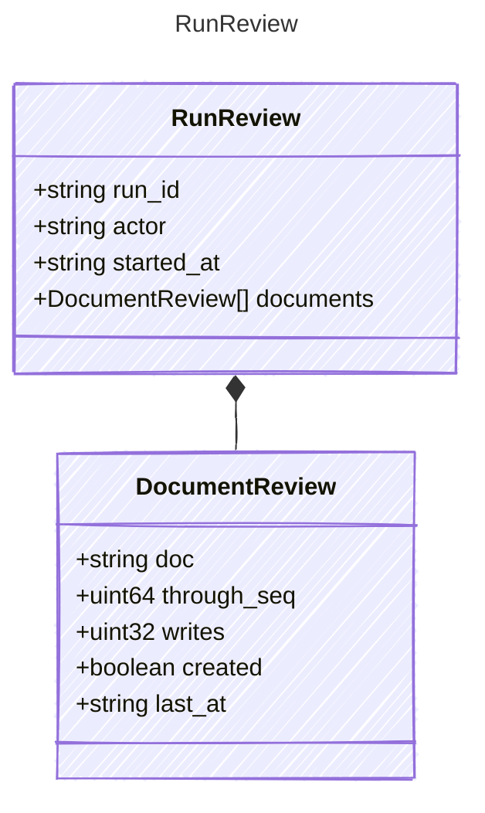

<!-- <auto-generated by typra-emitter> -->

A run with changes nobody has kept or undone yet. App edits run as an
auto-kept `user` run, so they never appear here.

## Class Diagram

## Properties

| Name | Type | Description |
| ---- | ---- | ----------- |
| run_id | string |  |
| actor | string |  |
| started_at | string |  |
| documents | [DocumentReview[]](../documentreview/) |  |

## Composed Types

The following types are composed within `RunReview`:

- [DocumentReview](../documentreview/)
