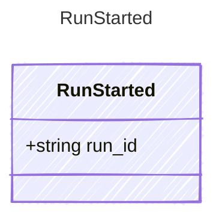

<!-- <auto-generated by typra-emitter> -->

A run that was started (`begin_run`); its writes wait for Keep or Undo.

## Class Diagram

## Properties

| Name | Type | Description |
| ---- | ---- | ----------- |
| run_id | string |  |
