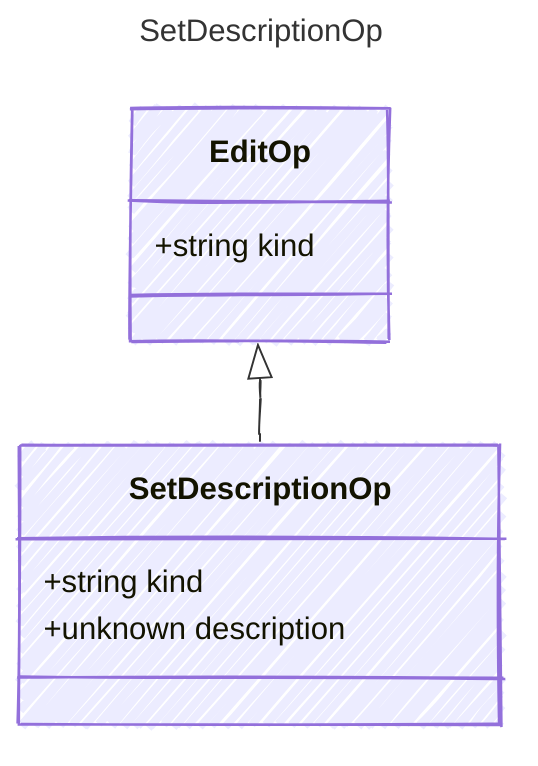

<!-- <auto-generated by typra-emitter> -->

Rich-text description; null clears it.

## Class Diagram

## Properties

| Name | Type | Description |
| ---- | ---- | ----------- |
| kind | string |  |
| description | unknown |  |
