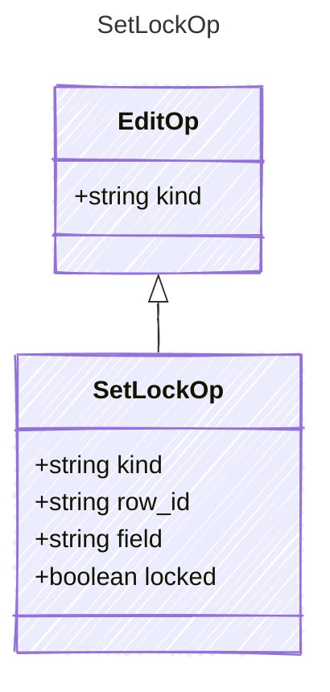

<!-- <auto-generated by typra-emitter> -->

Lock or unlock the sketch (no `row_id`), a whole row (`row_id`), or one cell
(`row_id` and `field`). Sketch and row locks apply to everything inside them.

## Class Diagram

## Properties

| Name | Type | Description |
| ---- | ---- | ----------- |
| kind | string |  |
| row_id | string |  |
| field | string |  |
| locked | boolean |  |
