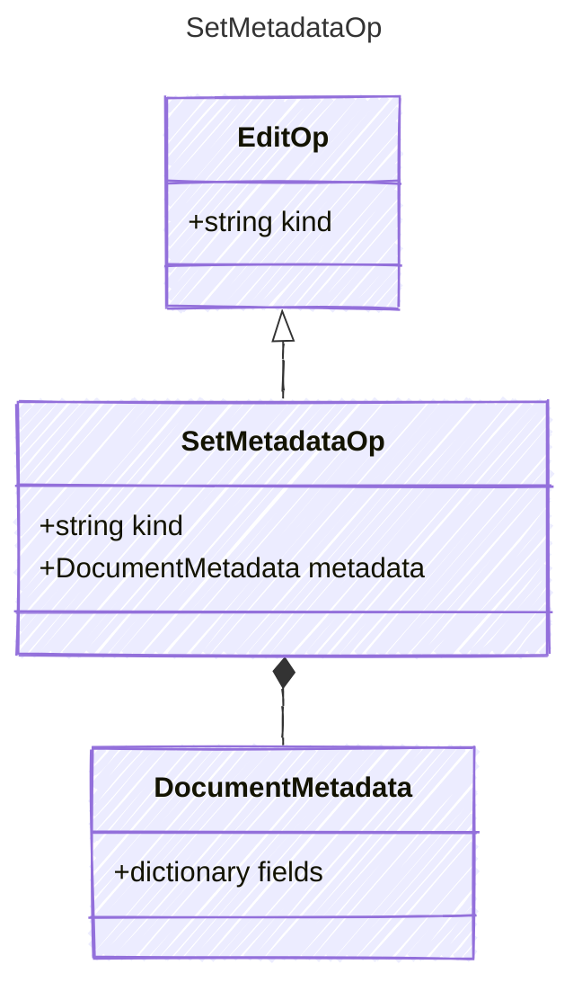

<!-- <auto-generated by typra-emitter> -->

## Class Diagram

## Properties

| Name | Type | Description |
| ---- | ---- | ----------- |
| kind | string |  |
| metadata | [DocumentMetadata](../documentmetadata/) |  |

## Composed Types

The following types are composed within `SetMetadataOp`:

- [DocumentMetadata](../documentmetadata/)
