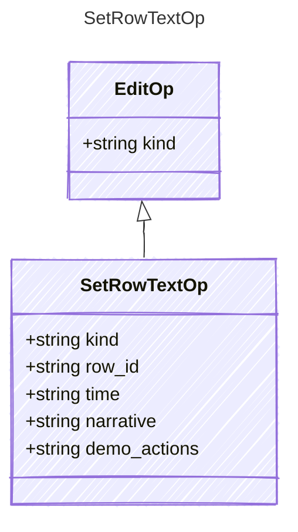

<!-- <auto-generated by typra-emitter> -->

Text cells to replace on one row; omitted cells are left untouched. A changed
`time` recomputes `duration_seconds` as in `RowTextUpdate`.

## Class Diagram

## Properties

| Name | Type | Description |
| ---- | ---- | ----------- |
| kind | string |  |
| row_id | string |  |
| time | string |  |
| narrative | string |  |
| demo_actions | string |  |
