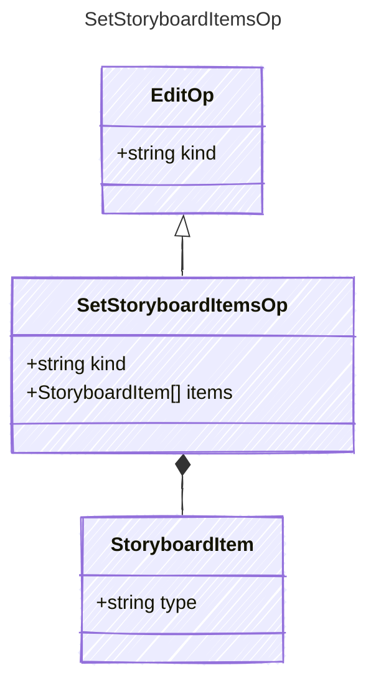

<!-- <auto-generated by typra-emitter> -->

Replace the storyboard's items, for reorders and bulk rewrites.

## Class Diagram

## Properties

| Name | Type | Description |
| ---- | ---- | ----------- |
| kind | string |  |
| items | [StoryboardItem[]](../storyboarditem/) |  |

## Composed Types

The following types are composed within `SetStoryboardItemsOp`:

- [StoryboardItem](../storyboarditem/)
